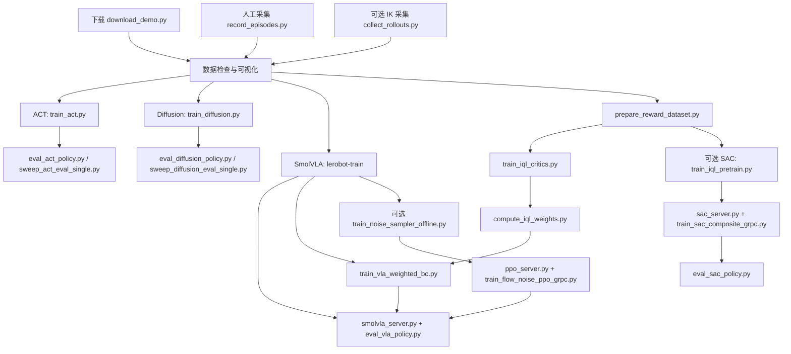

# SO-101 Lab 训练流程与程序顺序

本页按当前仓库入口梳理。它是一组可选实验路线，不是把所有 train 脚本依次执行。当前本机正在进行的是 ACT 行为克隆；上游结果不是本机实测结果。本文只说明流程，不会自动启动训练。

## 1. 总览



PPO 可以不使用采样器，也不要求先完成 IQL。SAC 可按奖励模式使用仿真奖励、分类器或 VIP，不要求总是走完图中的奖励标注和预训练。不同模型的检查点不能互换。

## 2. 环境与数据约定

| 环境 | 负责的阶段 |
|---|---|
| `conda activate lerobot-env` | 下载、数据 API 检查、ACT/Diffusion/SmolVLA 训练、奖励标注、IQL、模型服务端 |
| `conda activate isaac5.1-so-arm101` | 仿真、遥操作录制、闭环评估、在线 RL 客户端 |
| 安装 Rerun 的环境 | 数据可视化；可用独立 venv，也可用已有 Isaac 环境 |

在项目根目录执行命令。LeRobot 数据集由 `meta/`、`data/` 和 `videos/` 组成；状态和动作采用电机归一化表示，仿真内部使用弧度，转换由项目数据/推理模块处理。录制的监督关系是 `(执行动作前的观测, 动作)`，奖励在动作执行后补写。控制频率、相机键名与动作归一化必须在采集、训练和评估中对应。

## 3. 数据准备：选择一种来源

### 官方数据

```bash
conda activate lerobot-env
env -u ALL_PROXY -u all_proxy python scripts/tools/download_demo.py --dataset easy
python scripts/verify_lerobot_dataset.py data/recordings/easy_task_v1
```

`download_demo.py` → `verify_lerobot_dataset.py` → `visualize_lerobot_rerun.py`。

Easy 数据写到 `data/recordings/easy_task_v1`。下载器遇到非空目录就跳过，检查脚本只验证基本结构、加载及首样本，不审核所有示范。

### 自行采集

`calibrate_leader.py`（仅实体 leader 首次使用）→ `teleop_agent.py`（可选练习）→ `record_episodes.py` → 数据检查与可视化。

```bash
conda activate isaac5.1-so-arm101
python scripts/teleop/record_episodes.py \
  --output data/recordings/my_task_v1 \
  --env figure_shape_placement_easy \
  --teleop-device keyboard --reward-mode success
```

键盘操作保持 GUI，按 Space 开始遥操作，N 开始录制，F 保存，X 丢弃。`teleop_agent.py` 的任务参数为 `--task`，录制脚本则为 `--env`。

可选的 `eval/collect_rollouts.py` 使用 IK 脚本自动采集数据，并保存奖励辅助文件；位置在 eval 目录并不意味着它只做模型评估。

### 可视化与处理

```bash
# 在已安装 rerun-sdk 的环境中运行，不需要启动 Isaac Sim。
python scripts/visualize_lerobot_rerun.py \
  data/recordings/easy_task_v1 --episodes 0 1 2 --batch-size 100
```

必要时再使用 `tools/filter_dataset.py` 筛选 episode、`tools/trim_after_success.py` 裁剪成功后的多余帧、`tools/recompute_stats.py` 重算统计量。先检查各工具 `--help` 和输出设置，再处理数据；它们不是每次训练必跑的步骤。

## 4. 当前主线：ACT

程序顺序：

1. `scripts/train/train_act.py`：读元数据 → 构建特征和处理器 → 按时间索引取动作块 → DataLoader → 前向损失 → 反向更新 → 保存模型。
2. `scripts/eval/eval_act_policy.py`：在仿真中加载检查点，按观测预测动作，统计成功率。
3. `scripts/eval/sweep_act_eval_single.py`：按一致条件评估多个检查点，选择实际表现更好的模型。

```bash
conda activate lerobot-env
env -u ALL_PROXY -u all_proxy python scripts/train/train_act.py \
  --dataset data/recordings/easy_task_v1 \
  --config configs/policy/act/baseline.yaml --name act_easy_v1 \
  --num-workers 4 --best-check-interval 100 --tracker none
```

当前 YAML 为 60000 步、batch 24、chunk 25、执行 25 步、KL 权重 10。命令行覆盖 YAML；不能用旧实验文档的参数推断当前配置。

输出 `outputs/act_easy_v1/`，包括最终模型、处理器、`best/` 和周期检查点。`best/` 依据单批训练 loss，不是成功率。`--resume` 恢复模型、优化器、步数，但不精确恢复随机数和数据迭代器状态。

```bash
conda activate isaac5.1-so-arm101
python scripts/eval/eval_act_policy.py \
  --checkpoint outputs/act_easy_v1/best \
  --env figure_shape_placement_easy --episodes 20 --max-steps 500 --gui
```

评估后记录失败类型，再决定补充数据或改变参数。每次实验使用不同名称；一次只改变一个因素，并固定种子、任务、执行步数、超时及随机化设置。

## 5. 另外两条模仿学习分支

| 模型 | 训练入口 | 下游评估 | 区别 |
|---|---|---|---|
| Diffusion | `train/train_diffusion.py` | `eval/eval_diffusion_policy.py` | 历史观测窗口、动作 horizon、去噪训练及推理 |
| SmolVLA | 外部 LeRobot 的 `lerobot-train` | `eval/smolvla_server.py` + `eval/eval_vla_policy.py` | 模型依赖放在训练环境，通过 gRPC 与仿真通信 |

SmolVLA 普通 BC 没有本仓库的 `train_smolvla.py`，入口是已安装 LeRobot 的命令。训练变体与参数见 [03_bc_training.md](03_bc_training.md)；命令涉及外部库版本，运行前在本机核对 `lerobot-train --help`。已有下载权重可直接跳过训练。

VLA 评估先在 lerobot-env 启动 `smolvla_server.py --port 8080`，再在 Isaac 环境运行 `eval_vla_policy.py --checkpoint <模型目录> --env figure_shape_placement_easy`。模型由客户端初始化请求指定。任务文本也是模型输入，不能在对照实验中遗漏。

## 6. SmolVLA 的可选 IQL 优化：四个程序有严格先后关系

| 顺序 | 程序 | 输入 | 输出/作用 |
|---|---|---|---|
| 1 | `train/prepare_reward_dataset.py` | 示范、目标成功画面或分类器 | 含 `next.reward` 的数据副本 |
| 2 | `train/train_iql_critics.py` | 带奖励的数据 | 图像特征缓存及 Q/V 检查点 |
| 3 | `tools/compute_iql_weights.py` | 同一数据、缓存、critic | 写回 `iql_weight` 列及元数据 |
| 4 | `train/train_vla_weighted_bc.py` | 已训练 SmolVLA、带权重的数据 | 微调后的 SmolVLA |
| 5 | `eval/smolvla_server.py` + `eval/eval_vla_policy.py` | 微调检查点 | 与基线一致条件下的成功率 |

算法关系：`A = min(Q1,Q2) - V`；当前代码的权重是 `clip(exp(A / beta), 0, max_weight)`。高优势样本获得更大损失权重。不是训练完 critic 就自动改变策略，必须执行第 4 步。

代码边界与操作注意：

- ACT/Diffusion 的普通训练入口不使用此权重；此微调脚本替换的是 `SmolVLAPolicy.forward`。
- `prepare_reward_dataset.py` 可能补写源元数据；已有奖励的复制分支会删除现有输出目录。使用独立的新输出路径。
- `compute_iql_weights.py` 会原地写数据，当前固定处理 `data/chunk-000/file-000.parquet`；不能直接推广到任意多分片数据。可先 `--dry-run`。
- 当前脚本不生成 `iql_weights.pt`。图像缓存、数据行与 critic 编码器必须匹配。
- 加权脚本缺少 `iql_weight` 时退回普通 loss；它依赖 LeRobot 的逐样本损失接口，需在当前版本上验证后再长时间训练。

分步命令见 [04_offline_rl.md](04_offline_rl.md)，数据写入方式和公式以当前源码及本页说明为准。

## 7. 可选在线 PPO

已有 SmolVLA → 可选 `train_noise_sampler_offline.py` → `ppo_server.py` 与 `train_flow_noise_ppo_grpc.py` 配合 → VLA 评估。

- 离线采样器：固定 SmolVLA，优化生成动作时的初始噪声；不等同于 IQL。
- PPO 服务端（lerobot-env）：模型、VIP、轨迹缓存、优势估计和梯度更新。
- PPO 客户端（Isaac 环境）：采样动作 → 仿真执行 → 回传结果 → 一段 rollout 后请求更新。
- 默认分别使用 PPO 8081、VLA 推理 8080；以实际命令为准。
- `--auto-server` 需要正确的环境路径配置。当前两个 Python 环境的组合应使用 gRPC 版；单进程 `train_flow_noise_ppo.py` 是另一种兼容条件下的入口。

PPO 不保证提升，IQL 后接 PPO 也可能退化。IQL 价值初始化与 PPO 奖励尺度必须相容。详见 [05_online_rl.md](05_online_rl.md)。

## 8. 独立 SAC 路线

数据/自动 rollout → 按奖励模式进行标注 → 可选 `train_iql_pretrain.py` → `sac_server.py` + `train_sac_composite_grpc.py` → `eval_sac_policy.py`。

`train_iql_pretrain.py` 同时预训练 SAC actor 和 critic；`train_iql_critics.py` 只训练用于加权 BC 的 Q/V。这两个名字相近的脚本不能互换。

SAC 服务端管理 replay buffer 和网络，客户端管理环境与可选人工干预；默认服务端口 8082。若采用学习到的成功奖励，先用 `prepare_classifier_dataset.py` 和 `train_reward_classifier_v2.py` 准备分类器；使用其他奖励模式时无需强制训练分类器。详见 [05b_sac_rl.md](05b_sac_rl.md)。

## 9. 读代码的顺序与非训练工具

先读各入口开头的中文流程注释，再读 main 与关键阶段注释，最后跟进库实现：

| 想理解的内容 | 核心实现 |
|---|---|
| 任务和成功条件 | `so101_lab/tasks/` 中的 `env.py`、`env_cfg.py`、`rl/mdp/` |
| 数据记录与单位转换 | `so101_lab/data/collector.py`、`converters.py`、`lerobot_dataset.py` |
| ACT/Diffusion 仿真推理 | `so101_lab/policies/act/`、`diffusion/` |
| IQL/采样器/PPO 组件 | `so101_lab/policies/rl/` |
| RL 仿真适配与域随机化 | `so101_lab/rl/` |
| 服务通信 | `so101_lab/transport/` |

`tools/usd_to_stl.py` 用于道具模型转换和打印，属于场景/真机准备工具，不是训练流程的一步。真机部署在仿真评估之后按 [sim2real 文档](../reference/sim2real.md) 进行；仿真成功不代表已解决真机视觉和控制差异。


### PPO 启动时的 Protobuf 兼容问题

若报 `cannot import name runtime_version from google.protobuf`，原因可能是
通信代码由 Protobuf 6.x 生成，但 Isaac 环境使用 4.25.x。
仓库 PPO/SAC 通信代码现使用 `grpcio-tools==1.62.3` 重新生成，兼容本机 4.25.9；
不要仅删除版本检查，也无需为此升级 Isaac 的 Protobuf。

训练服务端需要通信依赖（本机已补装）：

```bash
conda activate lerobot-env
python -m pip install grpcio==1.80.0 protobuf==4.25.9
python scripts/train/ppo_server.py --port 8081
```

先启动服务端，再在 Isaac 环境重跑 PPO 客户端。跨环境 Ready RPC 已验证；
这项检查不包含 SmolVLA/VIP 加载或完整 PPO 梯度更新。

### 相机初始化报 unknown dtype / size=0

本机出现过 `SyntheticData._add_node_downstream_intergraph_dependency` →
`TypeError: Unable to write from unknown dtype, kind=f, size=0`。
检查发现 Isaac 环境使用 NumPy 2.4.6，而 `isaacsim-kernel 5.1.0.0` 要求
`numpy==1.26.0`，Isaac Lab 要求 `numpy<2`。不要把它当成 PPO 模型错误。

本机修复为以下兼容组合（安装在 Isaac 环境，不影响 lerobot-env）：

```bash
conda activate isaac5.1-so-arm101
python -m pip install "numpy==1.26.0" "opencv-python==4.11.0.86" "rerun-sdk==0.22.1"
```

Rerun 0.38.1 和 OpenCV 4.13 要求 NumPy 2，因此只降 NumPy 会留下依赖冲突。
项目可视化脚本已兼容 Rerun 0.22 的 Scalar/set_time_sequence 和新版的
Scalars/set_time。独立可视化环境仍可使用新版依赖，Isaac 环境不要无约束升级。

修复后已验证 Easy RL 环境创建、重置、两路 480×640 RGB 相机与一步动作执行，
并导出一个 episode 的 Rerun 文件。此验证不包含服务端模型加载和完整 PPO 更新。

### PPO 服务端 Init 报缺少 diffusers / SmolVLA 依赖

客户端显示 `Exception calling application: No module named 'diffusers'` 时，
异常来自 lerobot-env 服务端，不是 Isaac 客户端。按当前本机 LeRobot 的依赖范围安装：

```bash
conda activate lerobot-env
env -u ALL_PROXY -u all_proxy python -m pip install \
  'diffusers>=0.38.0,<0.40.0' 'transformers>=5.4.0,<5.6.0' \
  'accelerate>=1.14.0,<2.0.0' 'num2words>=0.5.14,<0.6.0'
```

本机安装版本为 diffusers 0.39.0、transformers 5.5.4、accelerate 1.15.0、
num2words 0.5.14。安装后需要重启 ppo_server.py，再运行客户端。
奖励包已改为按需导入，VIP/PPO 不会提前导入 SAC RewardClassifier；
这不代表当前 LeRobot 的 SAC 分类器接口已完成适配。
已验证 FlowNoiseSmolVLA、SmolVLA 策略类、处理器及 VIP 模块导入；
导入检查不等同于完整权重加载或 PPO 训练通过。

### PPO 动作采样报 fill_kv_cache 参数错误

新版 LeRobot 的 SmolVLMWithExpertModel.forward 不再接收 `fill_kv_cache`，
并用 Transformers DynamicCache 替代逐层字典。仅删除参数不足以修复 PPO：
还需要处理缓存保存、重评估和 suffix 追加后的前缀恢复。

`so101_lab/policies/rl/flow_noise_smolvla.py` 现在按 forward 签名适配新旧接口，
轨迹继续保存张量字典，新版调用时构建独立 DynamicCache 容器并裁回前缀。
修改后请重启 PPO 服务端，再运行原客户端命令。

本机验证：真实权重的动作采样、单条概率重评估一致性、缓存不变性、
单条/批量 actor 梯度，以及两条合成观测上的一次服务端 PPO 更新与检查点保存。
这不是完整物理仿真训练或策略成功率验证。
BF16 下改变重评估批大小会产生概率数值偏差，先保持默认 `--reeval-batch-size 1`。
手动回归检查：`python tests/test_flow_noise_smolvla_smoke.py`（lerobot-env、CUDA）。
